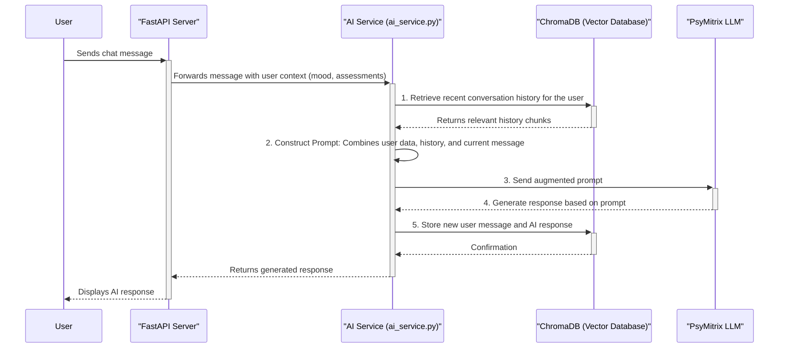

# AI Data Understanding with RAG and Vector Databases

This document explains how the AI in Psymitrix understands and processes information, particularly through the use of Retrieval-Augmented Generation (RAG) and a ChromaDB vector database.

## Core Concepts

*   **Large Language Model (LLM):** The core AI model (`Matrixxboy/PsyMitrix_psychiatrist`) that generates human-like text. By itself, it has general knowledge but lacks specific, real-time information about the user.
*   **Vector Database (ChromaDB):** A specialized database that stores information as "vectors" (numerical representations). This allows for searching based on semantic meaning and similarity, rather than just keywords.
*   **Retrieval-Augmented Generation (RAG):** The process of retrieving relevant information from a knowledge source (our vector database) and providing it to the LLM as context when generating a response. This makes the AI's responses more accurate, relevant, and context-aware.

## How the AI Understands Data: A Step-by-Step Flow

The following diagram illustrates the data flow when a user interacts with the Psymitrix AI chat.

### Explanation of the Flow

1.  **User Sends Message:** The user types a message in the chat interface and sends it.
2.  **API Receives Request:** The FastAPI server receives the message. It gathers relevant data about the user from the main database, such as their recent mood, assessment results, and other profile information.
3.  **AI Service Gathers Context:**
    *   The request is passed to the **AI Service**.
    *   The service queries the **ChromaDB vector database** to find the most recent and relevant parts of the *current user's conversation history*. This is done by searching for vectors that are semantically similar to the new message.
4.  **Prompt Construction (The "Augmented" part of RAG):** The AI Service constructs a detailed prompt for the LLM. This is the crucial step. The prompt includes:
    *   **User's current message.**
    *   **User's context:** Mood, assessment scores, etc.
    *   **Retrieved context:** The relevant conversation history chunks retrieved from ChromaDB.
5.  **LLM Generates Response:** The augmented prompt is sent to the `Matrixxboy/PsyMitrix_psychiatrist` LLM. Because the prompt is rich with specific, relevant context, the LLM can generate a response that is empathetic, personalized, and directly related to the user's situation and recent conversation.
6.  **History is Updated:** The user's new message and the AI's response are converted into vectors and stored in the user's collection within ChromaDB. This keeps the AI's "memory" of the conversation up-to-date for future interactions.
7.  **Response Returned:** The generated response is sent back to the user through the API.

## The Admin Knowledge Base

The system also includes a separate RAG pipeline for an administrative knowledge base (`admin_knowledge_base` collection in ChromaDB). This allows administrators to upload documents (PDFs, text files, etc.) that are converted into vectors. While this knowledge base is not currently used by the user-facing chatbot, it provides a powerful capability for future features, such as:

*   Answering user questions based on a corpus of mental health literature.
*   Providing information to administrators through a private interface.
*   Enhancing the AI's knowledge with curated, expert-validated information.

This dual-RAG architecture separates user-specific conversational memory from the general, administrative knowledge base, ensuring data privacy and relevance.
